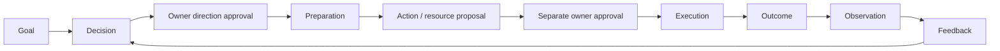

# AI Executive Team

A local-first, owner-controlled AI company command center. Eleven executives research, discuss, plan and propose work; the owner reviews direction and consequential actions. Goals, evidence, treasury, resources, experiments, memory, boards and activity records provide organizational history.

The current business workflow is **€0 research and private text practice**. The agents draft; the owner approves the exercise and assesses the sample. Passing a practice check does not establish customer demand, professional competence, profit or launch permission.

## Code documentation and maintenance

Start with [the developer guide](docs/DEVELOPMENT.md) for architecture, where to put changes, debugging and maintenance commands. [The searchable code catalog](docs/CODE_CATALOG.md) lists source modules, functions/classes and API handlers; it is generated from code without starting the application.

`./company format` applies consistent formatting and refreshes the catalog. `./company check-code` checks formatting and documentation freshness. The guide includes CI templates; enabling them requires GitHub workflow-write permission. Install the separate development tools as described in the guide. Use `./company audit` for functional verification.

## Conceptual foundation



Decision approval, action approval, resource provision and budget/capability checks are separate controls. Execution success and business outcome success are different records. A board card or an AI statement cannot grant approval.

The second path is `sources → research brief → comparison → approved private exercise → sample → owner review → revision`. Samples and reviews preserve history. Practice uses the existing model; it does not train a new one.

| Current capability | Owner use |
|---|---|
| Goals, meetings and recorded discussion rounds | Set direction and inspect proposals, critique, revisions and synthesis |
| Preparation, action provenance and resource requests | Follow decisions into separately reviewed work and access needs |
| Treasury and operating policies | Track funding/spend/refund, reservations and owner limits; funding is not revenue |
| Experiments, observations and follow-ups | Record expectations and dated results; unknown outcomes remain unknown |
| Executive memory and activity timeline | Review previous work, assumptions and recorded events |
| Development and Company boards, approved planning | Track product work separately from company work; dispatch reviewed planning recommendations |
| Business research and private practice | Review evidence, generated samples, checks and corrections under the €0 boundary |
| Departments, employees and character profiles | Organize assignments and presentation; fictional social records remain separate |

The current MVP is local and single-owner. Reliable useful delivery, demand validation and commercial accounting need further work before a money-making workflow. 3D offices, animated lives and improved faces/voices are future presentation work; personalities and avatars do not grant tools or authority.

See [the complete conceptual audit](CONCEPTUAL_SYSTEM_AUDIT.md) for the domain model, actors, use cases, story map, MVP boundaries and proposed backlog. [SPRINT_2_PLAN.md](SPRINT_2_PLAN.md) records current sprint status.

## Local startup for an existing installation

From this checkout:

```bash
./company doctor
./company start
```

Open `http://127.0.0.1:3000`. In another terminal in the same checkout, `./company key` copies the **existing** API key for dashboard login. `./company audit` runs checks with disposable data. The launcher preserves the database and `.env`, uses backend port 8001, starts in sandbox with Telegram and remote LLM disabled, and stops if ports are occupied. Existing eligible scheduled work may run while the application is awake.

Dependencies, `.venv/`, `node_modules/` and `.env` are excluded from Git. For a fresh installation use the manual setup below; do not replace an existing `.env` with the example.

## Prerequisites

- **Python 3.12** (not 3.13/3.14 — CrewAI's dependency chain has had build
  issues on newer Python versions). On macOS: `brew install python@3.12`
- **Node.js** (for the dashboard) — any recent LTS version
- **Ollama**, with the `llama3.1` model pulled:
  ```bash
  ollama pull llama3.1
  ```
  Do NOT use plain `llama3` — it does not reliably support tool-calling,
  which the CSO's research tool and every action-proposal tool depend on.
- **Playwright browsers** (for browser actions):
  ```bash
  playwright install chromium
  ```
- Optional: a **Telegram bot token** and your **chat ID** (see "Getting a Telegram bot"
  below if starting fresh)

## Backend setup

```bash
git clone <your-repo-url>
cd "AI Executive Team"

# Create and activate a Python 3.12 virtual environment
/opt/homebrew/bin/python3.12 -m venv .venv
source .venv/bin/activate

# Install dependencies
pip install --upgrade pip
pip install -r requirements.txt
```

### Configure secrets

```bash
cp .env.example .env
```

Edit `.env` and set:

| Variable | What it's for |
|---|---|
| `OLLAMA_MODEL` | `llama3.1` |
| `TELEGRAM_BOT_TOKEN` | From @BotFather on Telegram |
| `TELEGRAM_CHAT_ID` | Your personal chat ID (see `getUpdates` method) |
| `API_SECRET_KEY` | Long random owner-control key — generate one with `openssl rand -hex 32`. Required for protected API access. |
| `OPENAI_API_KEY` | Any non-empty placeholder string, e.g. `ollama-local-not-a-real-key` — required by CrewAI's OpenAI-compatible client even though Ollama never checks it |
| `SANDBOX_MODE` | `True` to start. Can also be toggled live from the dashboard (see below) — no manual editing needed after initial setup. |
| `WORKSPACE_ROOT` | `./workspace` by default. Every file operation and shell command touching a path is confined here — see Safety Architecture below. |
| `ALLOWED_BROWSER_DOMAINS` | Optional. Comma-separated domain allowlist for browser actions (e.g. `wikipedia.org,github.com`). Empty = any public http/https domain allowed; internal/private addresses remain blocked. |
| `CREWAI_DISABLE_TELEMETRY` | `true` by default for local-first privacy. |
| `SYNC_HMAC_KEY` | Recommended dedicated shared key for authenticated cross-machine JSONL sync. If empty, the API secret is used. |
| `ALLOW_UNSAFE_RAW_SHELL` | `False` by default. Live shell uses the isolated Docker worker if explicitly enabled; Docker must be installed with the pinned Alpine image digest pre-pulled. |
| `BIND_HOST` | `127.0.0.1` by default. Keep the API loopback-only unless you deliberately deploy a protected remote transport. |
| `ALLOW_INSECURE_REMOTE_HTTP` | `False` by default. A non-loopback plaintext HTTP bind fails startup unless you explicitly accept that transport risk. |
| `TELEGRAM_INCLUDE_SENSITIVE_DETAILS` | `False` by default. Action descriptions/details, paths, commands, URLs, errors, and transport details remain local unless explicitly enabled. |
| `TELEGRAM_ALLOW_REMOTE_CONTROL` | `False` by default. Telegram is notification-only unless the owner explicitly enables remote Approve/Reject/Execute. |
| `ALLOW_REMOTE_LLM` | `False` by default. Non-loopback model endpoints are blocked unless explicitly enabled; enabled remote endpoints must use HTTPS. |
| `SCREENSHOT_RETENTION_COUNT` | Number of private browser screenshots retained in the workspace (default `50`). Oldest action screenshots are pruned. |

### Verify the setup

```bash
python test_config.py
python verify_system.py
```

`verify_system.py` runs 140+ regression/security checks covering agent roster integrity,
endpoint auth, state-machine gates, treasury authority, signed sync, privacy,
workspace/file safety, browser/research SSRF boundaries, autonomous retries,
executive memory evidence separation, meeting types, and more. Run this after *any* code change, especially AI-generated ones — it has
repeatedly caught real regressions during development that looked fine at a
glance.

### Run the backend

```bash
python main.py
```

Runs on `http://localhost:8000`. On startup it:
- Checks whether daily research has already run today and catches up if not
  (no exact wake time needed — works across machines, whichever one is open
  first after 9 AM runs it)
- Starts the Telegram listener only when configured and enabled (see below)

## Frontend setup

```bash
cd executive-dashboard
npm ci
npm run dev
```

Open `http://localhost:3000`. You'll be prompted for the `API_SECRET_KEY`
from your `.env`. The dashboard keeps it in browser memory only; refreshing
the page intentionally requires re-entry so a future XSS cannot recover a
persisted control-plane credential.

The dashboard provides the command-center capabilities listed above. Use the launcher for the paired local backend/dashboard ports.

## Getting a Telegram bot (first-time only)

1. Message **@BotFather** on Telegram, send `/newbot`, follow the prompts.
2. Send any message to your new bot.
3. Visit `https://api.telegram.org/bot<YOUR_TOKEN>/getUpdates` in a browser —
   your chat ID appears in the JSON response.

When remote control is explicitly enabled, action proposals can arrive as interactive Telegram messages with
real **Approve / Reject / Execute** buttons — no need to open the dashboard
for routine approvals.

## What the executive team can actually do

Beyond discussing and deciding, agents can **propose real actions**, which
require explicit action approval before execution:

| Capability | Tool | Who has it | What it does |
|---|---|---|---|
| Shell commands | `propose_action` | COO, CTO | Proposal path retained for compatibility/testing. Live shell is disabled by default; opt-in requires a constrained, network-disabled Docker worker. |
| File read/write/append | `propose_file_operation` | COO, CFO, CTO, General Counsel | Structured file I/O — no shell involved, safer than a raw command |
| Browser navigate + click | `propose_browser_action` | COO | Navigates to a URL and optionally clicks one element, screenshots the result |

Proposals are persisted. Telegram delivery depends on configuration and opt-in.
Action execution requires owner approval; public source reads, record writes and eligible scheduled reasoning have their own workflow boundaries.

## Safety architecture

This is the part worth understanding before flipping to Live mode:

- **Sandbox mode (default)**: approving and "executing" an action never
  performs the proposed live operation — it records a simulated result. The
  application still writes its database, logs and backups and can read public sources. Toggle to Live mode from the dashboard banner
  (requires confirmation) when you're ready for real execution.
- **Danger-pattern blocklist**: known catastrophic commands (`rm -rf /`,
  fork bombs, `curl | bash`, `sudo`, etc.) are blocked outright, in both
  sandbox and live mode.
- **Structured workspace confinement**: file operations resolve paths inside
  `WORKSPACE_ROOT`; writes are atomic and owner-only. Raw shell path parsing
  remains heuristic defense-in-depth and is therefore **not** considered a
  security sandbox.
- **Live raw shell default-off**: host shell could access OS resources in ways
  string/path inspection cannot reliably model. Live shell execution fails
  closed unless the owner explicitly sets `ALLOW_UNSAFE_RAW_SHELL=True`; enabled commands run only inside the constrained Docker worker.
- **URL/network safety**: browser actions validate every HTTP(S) request,
  including redirects and subresources, block service workers/downloads, and
  reject loopback/private/link-local targets. Research revalidates redirects,
  restricts ports/content types, and caps response bodies.
- **Execution lock**: only one heavy CrewAI run (a meeting or research cycle)
  executes at a time, system-wide — prevents a scheduled run and a manual
  one from overlapping and doubling CPU/heat load.
- **Duplicate-proposal guard**: if an agent calls the same proposal tool
  with the same arguments repeatedly within 90 seconds (a known local-LLM
  failure mode — one incident produced 13 identical proposals before this
  existed), only the first call creates a proposal; the rest are rejected
  and the agent is told to stop.
- **`max_iter=5`** on every agent: a hard cap on reasoning/tool-call
  iterations per task, independent of the guard above.
- **Reasoning is tool-free**: daily research, ad-hoc decisions, and autonomous
  reasoning use `EXECUTIVE_AGENTS_NO_TOOLS`. Tool-capable executives are used
  only after the owner approves a decision and explicitly starts preparation;
  resulting actions/resources still require their own owner gates.
- **In-progress guard**: daily research cannot run twice concurrently, even
  if two triggers land close together (a real race condition this project
  hit once, now structurally prevented).
- **Auth**: sensitive read and write API surfaces require `X-API-Key`.
  The backend binds loopback by default and CORS is restricted to the local
  dashboard origins. Invalid guesses are rate-limited without allowing an
  attacker to lock out a request that presents the correct owner key.
- **External-channel privacy**: Telegram is notification-only by default.
  Remote Approve/Reject/Execute requires explicit opt-in, and action
  descriptions/paths/commands/URLs/errors stay local unless sensitive-detail
  egress is separately enabled. Transport-library exception details and
  unauthorized sender identifiers are suppressed from logs.
- **Filesystem race resistance**: structured file I/O walks the workspace using
  descriptor-relative `O_NOFOLLOW` operations, rejects special/multi-hard-link
  targets, caps reads/writes, and preserves atomic owner-only writes.
- **Runtime artifact privacy**: database/backups/sync/logs/screenshots are
  owner-only where supported; screenshot serving refuses symlink escapes and
  rotated logs are hardened back to mode `0600`.
- **Telegram owner identity**: action buttons are accepted only from the
  configured owner's private Telegram chat/user. Telegram uses the same
  treasury/goal-aware action-control functions as the API.
- **Local-first telemetry/model transport**: CrewAI telemetry is disabled by
  project default. A non-local Ollama URL fails startup unless the owner
  explicitly enables remote LLM transport, and remote model endpoints must
  use HTTPS because prompts/context may leave the machine.
- **Authenticated sync, local authority**: JSONL sync rows are HMAC-signed.
  Remote approved/executing actions do not import as local execution
  authority, and remote active reservations do not import as local spending
  authority.

## Project structure

```
agents/executive_agents.py       — 11 executive agent definitions, plus tool-less clones for daily research
workflows/meeting.py             — multi-agent sequential meeting logic (CEO always synthesizes last)
workflows/daily_research.py      — research → verify → meeting → log → notify pipeline (async)
workflows/action_executor.py     — executes approved actions: shell, file operations, browser actions — with all safety guards
workflows/execution_lock.py      — system-wide lock preventing overlapping heavy runs
tools/research_tool.py           — web page reading tool (requests + BeautifulSoup)
tools/action_proposal_tool.py    — propose_action (shell commands)
tools/file_operation_tool.py     — propose_file_operation (read/write/append)
tools/browser_action_tool.py     — propose_browser_action (navigate + click)
tools/_dedupe_guard.py           — shared duplicate-call protection for all propose_* tools
memory/database.py               — SQLite: decisions, action queue, full action history
notifications/telegram_bot.py    — Telegram notifications (HTML parse mode)
notifications/telegram_interactive.py — interactive Approve/Reject/Execute buttons
main.py                          — FastAPI backend, scheduling, auth, sandbox toggle
verify_system.py                 — smoke test for core invariants — run after any code change
executive-dashboard/             — Next.js dashboard (separate npm project)
```

## Known limitations

- `llama3.1:8b` running locally has inconsistent native tool-calling — the
  research workflow has a built-in retry guard (3 attempts) that detects and
  retries when the CSO fabricates tool output instead of genuinely calling
  the tool. If it fails all 3 attempts, it logs an honest failure rather than
  fake research.
- Scheduling requires the laptop to actually be running — there's no
  wake-from-sleep. The catch-up check means whichever machine you open first
  after 9 AM runs it, but two machines with separate local databases won't
  know what the other already did (occasional duplicate research on days you
  switch machines — a minor inefficiency, not a bug).
- Browser actions support navigate + click only — no form-filling. Typing
  into a field (e.g. a login form) is a meaningfully bigger trust question
  than clicking a public button, and was deliberately left out of scope.
- Practice and memory do not train model weights or establish professional competence.
- Live shell is default-off and uses a constrained Docker worker when enabled.
- SQLite is not application-encrypted. Owner permissions and full-disk encryption protect local storage; optional authenticated encrypted backups are implemented in `memory/encrypted_backup.py`. Backup key recovery remains an operational responsibility.
- Durable run/step checkpoints and transactional claims support recovery. Ambiguous external effects still need reconciliation; arbitrary providers do not offer universal exactly-once execution.
- Generated logs, screenshots and registered sync exports use the owner's 30-day retention policy while the application runs. Approval/execution and domain histories are retained. Signed JSONL sync covers selected records and is not a complete database backup.
- Known dependency advisories and deployment requirements remain tracked in [SECURITY_RELEASE_GATE.md](SECURITY_RELEASE_GATE.md). Merged features do not clear that gate.

## Automated security checks

GitHub Actions runs the **Security and Foundation Checks** workflow on pull
requests and pushes to `main`. It uses the supported Python 3.12 runtime,
compiles the backend, runs Bandit, audits Python dependencies with
`pip-audit`, and runs the frontend lint/build plus `npm audit`. Dependabot
also watches Python, npm, and GitHub Actions dependencies. CrewAI remains
deliberately protected from automatic major/minor upgrades because runtime
stability and tool behavior must be revalidated manually.

## Foundation audit

See [FOUNDATION_AUDIT.md](FOUNDATION_AUDIT.md) for the pre-frontend security/privacy audit, residual risks, and architecture lessons from comparable agent systems.

## Character and voice review

BE-18/19 were reviewed and accepted by the owner on 10 October 2026. Feminine portraits now have a distinct illustrated face and professional silhouette; Kai’s specified appearance is retained. Local system voices can be compared, and optional Kokoro neural auditions can be prepared with `./company voices`. This creates a separate pinned `.voice-venv`, downloads digest-verified models, and generates fixed public comparison samples locally. No cloud speech text or paid provider is used. Audition/preferences do not yet voice generated conversations. See [SPRINT_2_CHARACTER_VOICE_REVIEW.md](SPRINT_2_CHARACTER_VOICE_REVIEW.md) for listening instructions, installation limits and test evidence.


## Before Sprint 3

See [PRE_SPRINT_3_AUDIT.md](PRE_SPRINT_3_AUDIT.md) for the current conceptual, security, privacy and bug review. `./company audit` now includes eight application browser suites, actual audition playback, Docker isolation and local Ollama inference using disposable data and logs. Passing project checks does not establish business demand, earned profit or production readiness; the dependency findings remain visible.

Sprint 3 selected scope and acceptance examples: [SPRINT_3_PLAN.md](SPRINT_3_PLAN.md). BE-20–22 add structured private exercises, frozen business evidence comparisons and assessment-based feedback tracking within €0/no-launch constraints. Implementation and review steps: [SPRINT_3_PRACTICE_EVIDENCE.md](SPRINT_3_PRACTICE_EVIDENCE.md). BE-20–22 are accepted and merged in PR #36. BE-23 local spoken contributions were reviewed by the owner and merged in PR #37.

### Local spoken contributions (BE-23)

Save an executive's Kokoro neural voice in People & simulation, then use **Load spoken contribution** in Conversations & activity or published discussion rounds. Audio is generated locally, loaded privately and can be stopped/deleted. The default expiry is 30 days; long contributions are rejected without silent truncation. See [BE23_LOCAL_CONVERSATIONS.md](BE23_LOCAL_CONVERSATIONS.md) for review steps, bounds and retention settings.

## Sprint 4 planning

See [SPRINT_4_PLAN.md](SPRINT_4_PLAN.md) for BE-24–33: quality benchmarks, reusable skills, private artifacts, run inspection, workflow templates, evidence-linked knowledge and a first 3D floor, followed by integration audit and retrospective. Implementation and owner review progress are recorded in that plan; prototype limitations remain explicit. Current budget and permitted loss remain €0.

Sprint 4 first review increment: [shared contracts](docs/SPRINT_4_CONTRACTS.md) and [local AI quality benchmarks](docs/BE24_QUALITY_BENCHMARKS.md). Run `./company quality` or `./company quality run --json-output`, then `./company quality summary`. These fictional measurements preserve raw failures and do not approve company work.

BE-25 adds an [Executive skill library](docs/BE25_EXECUTIVE_SKILLS.md) under Business research: review-bound immutable procedures, separate owner acceptance, compatible new-exercise reuse and revocation. Procedure use grants no tools, spending or launch permission.

BE-26 adds [private practice files](docs/BE26_PRIVATE_ARTIFACTS.md): exact TXT/Markdown exports, immutable provenance, authenticated downloads and revision comparisons. Exported bytes expire after 30 days; saved sample text and review records remain.

BE-27 adds the [Run inspector](docs/BE27_RUN_INSPECTOR.md) under Business research: private progress metadata, cooperative stop and explicit guarded continuation. Uncertain external actions are never replayed by this feature.

Reviewed workflow patterns and explicit source proposals: [BE-28 review and recovery](docs/BE28_WORKFLOW_QUEUE.md). Templates retain the existing practice approval gates; queued URLs do not count as evidence.

Company knowledge links existing goals, decisions, actions, outcomes, lessons and review-backed skills. It explains why corrected or stale memories are withheld from current agent context: [BE-29 review and retrieval limits](docs/BE29_COMPANY_KNOWLEDGE.md).

Dashboard redesign: see [the layout and verification notes](docs/DASHBOARD_REDESIGN.md). Navigation is grouped in the sidebar; Business research has separate practice, run inspector and skill tabs.

Virtual office now includes the [BE-30 executive floor prototype](docs/BE30_OFFICE_FLOOR.md), with local camera controls, opt-in decorative movement and the existing 2D directory.

Sprint 4 integration audit: [BE-32 findings, boundaries and short review commands](docs/BE32_SPRINT4_AUDIT.md). Use `./company audit` for disposable checks; your existing key and company database are preserved.

Sprint 4 retrospective: [BE-33 evidence, lessons and proposed next-sprint actions](SPRINT_4_RETROSPECTIVE.md). Next-sprint priorities and pending merges require owner agreement.

Sprint 4 owner review and merge are complete: BE-24–33 and UX-01 are Done for their documented scope (PRs #39–48). Next-sprint priorities remain proposed; known upstream findings stay visible in the security release gate.

Sprint 5 planning: [useful AI work, clearer review and reliable recovery](SPRINT_5_PLAN.md), BE-34–42. Planning cards only; implementation has not started.
