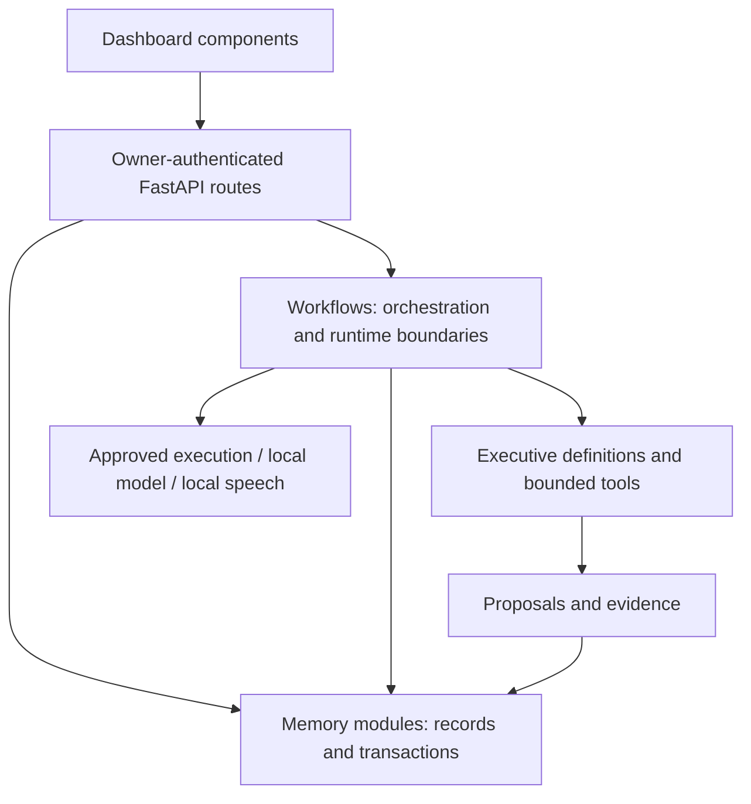

# Working on the code

Start here when you need to locate a feature or diagnose a fault. [The code catalog](CODE_CATALOG.md) lists every first-party Python module, its top-level functions/classes, dashboard source files and API route handlers. It is generated from source syntax, without running the app or loading private data.

## Architecture and ownership



| Location | Responsibility | Put changes here when… |
|---|---|---|
| `main.py` | Application lifecycle, auth, scheduler and core company API | Startup, owner login or core decisions/actions/goals change |
| `foundation_api.py` | Planning/operating routes and feature-router assembly | Planning, capability inventory, observation jobs or activity streams change |
| `api/common.py` | Strict request base, API error mapping and private response headers | Shared request/response behavior changes |
| `api/business.py` | Business research/practice HTTP contracts | Business form fields or endpoints change |
| `api/people.py` | Characters, departments, employees and fictional simulation HTTP contracts | People/organization endpoints change |
| `api/conversation_audio.py` | Published contribution speech HTTP contracts | Audio load/read/cancel/delete endpoints change |
| `memory/` | SQLite records, version checks, ledger changes and provenance | Data fields, migrations or state transitions change |
| `workflows/` | Meetings, dispatch, quality contracts, recovery and execution | A multi-step process or runtime boundary changes |
| `agents/` | Executive identities, role prompts and tool assignment | Personality, role or allowed tools change |
| `tools/` | Narrow agent-facing operations and proposals | An executive needs a bounded tool |
| `notifications/` | Telegram notifications and owner callbacks | Notification delivery or callback verification changes |
| `executive-dashboard/app/components/` | Feature panels and owner interaction | A dashboard feature's presentation changes |
| `executive-dashboard/app/lib/` | Reusable report/presentation logic | Shared frontend interpretation changes |
| `tests/` | Backend regression and security tests | Records or boundaries need regression coverage |
| `scripts/` | Local launcher, disposable audits and browser smoke tests | Developer commands or end-to-end verification change |

Keep route handlers thin: validate input, call the owning module, return a result. Keep SQL inside storage modules and runtime work inside workflows. Feature routers inherit owner auth at their assembly in `main.py`; they also retain private response headers. Do not mount them directly without those dependencies. `foundation_api.py` preserves the existing business request-model imports for compatibility.

## Following a feature

For spoken contributions: dashboard `conversation-voice.tsx` → `api/conversation_audio.py` → `workflows/conversation_audio.py` → isolated `scripts/synthesize_conversation.py`. Source text comes from the published contribution/discussion records; no new model reasoning is generated. Read [BE23_LOCAL_CONVERSATIONS.md](../BE23_LOCAL_CONVERSATIONS.md) for limits and cache behavior.

For business practice: dashboard `business-discovery.tsx` → `api/business.py` → `workflows/business_discovery.py` → `memory/business_discovery.py`, `memory/practice_quality.py` and `memory/business_practice_history.py`. Contracts under `workflows/` constrain deliverables; the owner's assessment is a separate record.

For an action: approval in `main.py` → transactional approval/budget operations in `memory/database.py` → `workflows/action_executor.py` → constrained runtime → recorded execution and outcome. A successful execution is different from a successful business result. Never infer approval from AI text or a board status.

## Documentation and style

- Use a module docstring to explain responsibility and relevant boundaries. Document public contracts and surprising constraints; avoid comments that repeat each assignment.
- Explain why a lock, transaction, validation, redaction or stop condition exists. Document what a function changes, what it returns, what it rejects and whether retry is safe when those facts are significant.
- Keep existing domain terminology consistent: direction approval, action approval, observation, owner assessment and fictional simulation are different concepts.
- Python uses pinned Black with Python 3.12 and 88-column formatting. Dashboard sources use pinned Prettier and existing ESLint. Generated/vendor/runtime files are excluded from formatting.
- Formatting is deliberately a mechanical change. Do not mix a broad formatting pass with new product behavior. Keep feature helpers with their owning module; extract shared code only when it has multiple real callers.
- Regenerate the catalog after adding/removing/moving source files or renaming top-level symbols. Historical sprint/audit documents remain historical; the README and this guide describe current structure.

Install maintenance tools once in this checkout:

```bash
.venv/bin/python -m pip install -r requirements-maintenance.txt
cd executive-dashboard
npm ci
cd ..
```

Then use the same simple launcher:

```bash
./company format      # Reformat source and regenerate the code catalog
./company check-code  # Check formatting and catalog freshness; no app startup
./company audit       # Functional/security/browser checks on disposable data
```

`format` modifies code files. `check-code` reports drift without modifying them. Neither command creates a new API key or alters the company database. Maintenance checks do not replace functional tests.

## Finding and fixing a fault

1. Record what you expected, what happened, the dashboard panel and error. Never paste API keys, credential values or private company records into a public issue.
2. Run `./company doctor` for environment/port problems. A `401` points to owner-key mismatch; a `429` can follow repeated failed auth. Use `./company key` to copy this checkout's existing key privately.
3. Find the route in the catalog and follow its owning workflow/storage module. Read the relevant feature document before changing authority or state transitions.
4. Reproduce with disposable records. Add a regression test for the behavior or boundary that failed; do not turn generated AI claims into test evidence.
5. Make the smallest correction in that owning module. Format/check it, then run appropriate tests. Use `./company audit` before a broad refactor is reviewed.
6. Review the diff and explain what changed, why, what passed and what remains unknown. Merge only the reviewed change.

Useful searches from the checkout root:

```bash
rg -n 'conversation-audio' api workflows executive-dashboard/app tests
rg -n 'def approve_action|def execute_action' main.py memory workflows
rg -n 'FAIL|ERROR|UPSTREAM' audit-results/<report-directory>
```

The backend terminal shows requests and runtime errors. Audit reports contain individual check logs. Log retention/redaction and backup handling are described in [PRIVACY_OPERATIONS.md](../PRIVACY_OPERATIONS.md). Do not import the app just to generate docs: initialization can configure logging/framework state.

## Database and reliability rules

Use parameterized SQL for values; validate identifiers and optimistic versions. Preserve immutable approval/evidence/sample history. Schema changes belong in the owning initialization path and must handle an existing database, not only a new one. Reconciliation must respect live claims and instance locks. An interrupted external action must not be replayed merely because its result is unknown.

Private generated audio, screenshots and exports are separate from durable company history. Keep secrets in private environment/configuration, not in doc examples, URLs, fixtures or Git. Run integration checks through the disposable audit rather than against real company actions.

## Reviewing a formatting change

The mechanical source-formatting commit is recorded in `.git-blame-ignore-revs`, so historical fault investigation can skip it. GitHub recognizes this file. Locally, opt in with `git config blame.ignoreRevsFile .git-blame-ignore-revs`. Review functional extraction separately from whitespace; `git diff -w` helps focus on changed structure.

## Remaining structural work

The API presentation/business/audio features now have separate modules. `main.py` and `memory/database.py` are still large legacy modules. Their catalog provides a function/route lookup; future extraction should move one domain at a time with schema, auth, transactional and recovery checks. A consistent format and index make these modules easier to navigate but do not prove every possible bug is absent. The known Chroma dependency findings remain tracked in the security release gate.

## GitHub workflow setup

The current GitHub credential cannot push workflow changes. Local maintenance checks are working, but automatic maintenance CI is not enabled by this PR. The reviewed configuration is saved in [ci/code-maintenance.yml](ci/code-maintenance.yml); the existing security workflow with added `api/` coverage is saved in [ci/security.yml](ci/security.yml). With a credential authorized to update workflows, copy these files into `.github/workflows/` under the same filenames, then commit and push. Do not assume the old security workflow directly scans `api/` until that patch is applied. The disposable local audit already includes `api/` in Bandit scans.

## Cleanup verification (10 October 2026)

Full disposable audit `audit-results/20261010-195208`: 188 backend tests, 150 foundation checks, all nine browser flows, Docker isolation, Bandit, frontend lint/build/audit, voice dependencies and local Ollama inference passed. Maintenance formatting and catalog checks passed. Syntax comparison confirmed unchanged executable code in 111 formatted Python files and every extracted API function/request model; launcher/audit wiring changes were reviewed separately. Existing four Chroma advisories remain reported, with no additional Python dependency findings. These checks establish regression coverage, not proof that all future faults are impossible.
