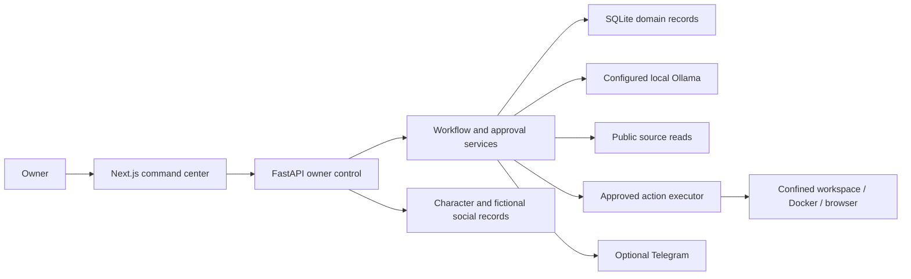
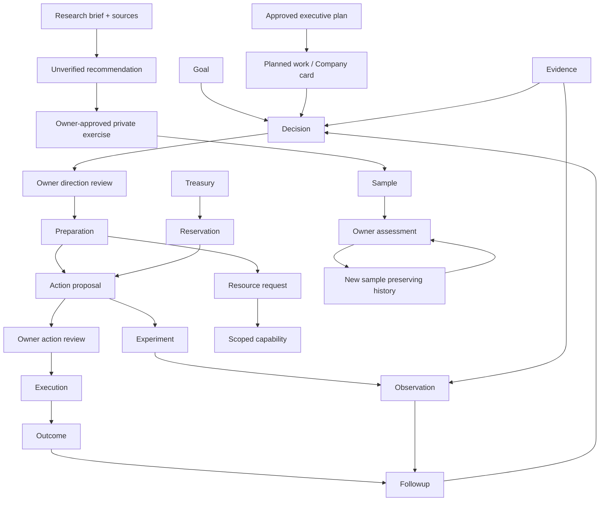

# Conceptual system audit

Dated technical/research record; results and limitations apply to the versions described. Use [the README](../../README.md) for current status and planning.

Date: 10 October 2026. Baseline: merged main `8e40830ffa7fddbed4f598495fd8319b4b77e6b6` (BE-17, PR #31).

This is a code-grounded design review, not a fresh runtime/security certification. It maps the existing domain, user journeys and product boundaries before the next implementation sprint. [SECURITY_RELEASE_GATE.md](../../SECURITY_RELEASE_GATE.md) remains the deployment authority.

## Product purpose and current boundary

The intended product is an AI-operated company: executives research options, propose work, practice skills, execute specifically approved work, measure results and use evidence to improve. The owner chooses direction and reviews consequential steps; the product must not assume the owner supplies professional delivery skills.

The current business discovery boundary is **€0 spending, €0 permitted loss, private text practice, no publishing or customer contact**. These restrictions belong to that workflow. They do not mean every general treasury or operating-policy record elsewhere automatically has a zero limit.

The current MVP is a local owner-controlled command center with organizational records and a research/practice feedback loop. A profitable autonomous company is a future objective, not an implemented or demonstrated capability. Personalities are role prompts for existing models, not independently trained people or verified professional qualifications.

Future presentation includes recognizable faces, bodies and voices, a navigable 3D office and visible employee activity. Fictional relationships and personal lives must remain separate from operational evidence and authority. Kai Akira's requested appearance and established identities, including women, should guide character work. Neither an avatar nor a fictional marriage grants access, competence or spending permission.

## Actors and system context

| Actor | Responsibility | Boundary |
|---|---|---|
| Owner | Sets goals, reviews plans/decisions/resources/actions/results | Current single-owner control; not a multi-user permission model |
| Eleven executives | Role-specific research, recommendations, critique and preparation | Shared configured model; authority comes from controls, not personality |
| Virtual employees | Organizational roles, capacity and work assignments | Assignment records do not create autonomous tool execution |
| Scheduler | Dispatches eligible approved planning work, observations and follow-ups | Requires a running machine; cannot grant approvals |
| External providers | Local Ollama, public pages, optional Telegram and constrained execution tools | Distinct privacy and capability boundaries |
| Future customers | Potential demand and delivery counterparties | No current business launch/contact authority |

Public source reading sends network requests. Sandbox action execution does not make the entire application offline: the application still writes records, logs and backups and can read public sources or call its configured model.

## Bounded contexts and implementation map

These are conceptual boundaries within the existing application, not a proposal to split it into microservices.

| Context | Principal implementation | Meaning |
|---|---|---|
| Direction and governance | `memory/database.py`, `workflows/action_control.py` | Goals, decisions, approvals, preparation, action proposals |
| Evidence | `memory/evidence.py` | Source records, verification, freshness and entity links |
| Planning and boards | `memory/planning.py`, `memory/agile.py`, `workflows/executive_planning.py` | Reviewed plans, dependency-aware work, separate Development and Company boards |
| Discussion | `memory/discussions.py`, `workflows/discussion_rounds.py` | Proposal, critique, revision and synthesis with published-claim checks |
| Resources and policy | `memory/capabilities.py`, `memory/operating_policies.py` | Resource provision, scoped capabilities, revocation, owner limits |
| Treasury | `memory/database.py` | Currency-specific funding, spend, refund and reservations |
| Outcomes and experiments | `memory/experiments.py`, `memory/observation_jobs.py` | Action-linked hypotheses, observations and bounded collectors |
| Research and practice | `memory/business_discovery.py`, `memory/business_practice_history.py` | Brief, comparison, approved private exercise, samples and owner reviews |
| Organizational memory | Executive memory and memory-review modules | Structured facts, assumptions, owner preferences, expiry and review |
| Organization and presentation | `memory/organization.py`, `memory/character_profiles.py`, `memory/personal_simulation.py` | Departments, employees, character preferences and explicitly fictional life events |
| Activity and recovery | Activity stream, `workflows/step_checkpoints.py`, `workflows/durable_task.py` | Recorded events, durable claims, cached results and interrupted-work reconciliation |
| Operations | `scripts/company_cli.py`, backup/sync/retention modules | Local startup, disposable audits, recovery and artifact handling |

## Domain model

The diagram shows semantic relationships, not a literal SQL foreign-key schema. Some evidence, goal and provenance links are optional; their existence must be checked in the specific record.

Important meanings:

- **Decision:** a recommendation and its owner direction review. It is not an execution instruction by itself.
- **Preparation:** proposals and missing resources for an approved direction. Starting preparation does not approve its outputs.
- **Action:** a separately reviewed executable proposal. Execution success says whether the operation ran; outcome success says whether it achieved the intended result.
- **Experiment:** an action-linked hypothesis with budget/risk/measurement details. Observations are dated records, not model guesses.
- **Evidence:** source content with provenance and verification status. Owner-confirmed, unverified and independently established are different claims.
- **Treasury:** capital and expenditures. Current entry types are funding, spend and refund; there is no implemented sales/revenue/profit ledger.
- **Practice review:** an owner's assessment of a particular sample against particular checks. Passing does not prove customer demand, repeated competence or permission to launch.
- **Memory:** retained knowledge and assumptions. Practice does not train model weights.
- **Board card:** work tracking. Moving it to Done grants no operational approval or access.
- **Capability:** scoped access inventory and verification. A named resource request is not a completed service integration.

## State and authority rules

The operations path is `goal → decision → direction approval → preparation → proposal → action approval → execution → outcome → observation/follow-up`. Resource provision, capability verification and budget checks may intervene before execution. Rejection, revoked access, unknown required cost or stale work must stop the relevant transition.

The private practice path is `draft → research_running → research_ready → practice_ready → practice_running → sample_ready → reviewed`. Revision creates another sample through `revision_running`; failures or interrupted generation can require review. Sample and review history preserve earlier records. Owner review can fail a sample, request correction and assess the new version without overwriting earlier evidence.

Approved executive plans dispatch eligible, dependency-aware **tool-free recommendations**. Their resulting decisions/actions retain separate owner gates. Arbitrary board cards are not picked up with unrestricted execution authority.

Durable checkpoints reduce duplicate work and preserve successful steps. An interrupted external effect cannot universally be retried safely: ambiguous effects require reconciliation. Exactly-once execution across arbitrary external providers is not promised.

## Use cases

| ID | Owner goal | Existing path | Important alternative |
|---|---|---|---|
| UC-01 | Start and inspect the local company | `company doctor/start/key`, dashboard health | Occupied ports or invalid config stop startup; existing key is preserved |
| UC-02 | Establish persistent direction | Goal creation and lifecycle | Inactive goal prevents dependent work requiring active direction |
| UC-03 | Compare recommendations | Meetings and recorded discussion rounds | Unsupported claims or invalid critique are withheld/qualified |
| UC-04 | Prepare an approved direction | Preparation, action/resource proposals | Missing resources are recorded; proposal is not approval |
| UC-05 | Perform a controlled operation | Owner action approval, policy/capability/budget checks, executor | Revocation or ambiguous interrupted execution prevents blind continuation |
| UC-06 | Measure an experiment | Action-linked experiment and dated observation | Unknown outcome remains unknown; collector support is bounded |
| UC-07 | Research and practice privately | BE-17 brief, sources, exercise approval, sample and review | Weak sources do not establish demand; failed checks require correction |
| UC-08 | Coordinate work | Approved plan, dependencies, Company board | A Done card does not execute an action |
| UC-09 | Learn from previous records | Outcomes, follow-ups, structured memory, retrospectives | Model suggestions are not verified achievements or owner acknowledgement |
| UC-10 | Manage organizational presentation | Departments, employee assignments, profiles, fictional events | Fiction is excluded from business evidence and authority |
| UC-11 | Develop and review the product | Development board, tests, owner acceptance, PR merge | Development status is separate from company execution status |
| UC-12 | Recover and preserve privacy | Backups, optional encrypted backups, retention, signed partial sync | Sync is not a complete database backup; key recovery must be planned |

### Representative acceptance examples

**Private practice:** owner supplies a fictional task-app brief with creating, editing and completing tasks; reminders are unknown. The owner approves a private guide exercise. Generated UI controls must not be invented. Owner assesses each observable check, records failure if needed and reviews a new sample. Passing those checks records only that sample's assessment. The due date in this practice record does not itself create an automatic observation job.

**Controlled action:** owner approves a decision, starts preparation and reviews its action proposal. Before execution, current policy, goal, budget and capabilities are checked. If the worker stops after a possible external effect, recovery records uncertainty and requires reconciliation rather than silently doing it twice. Result and business outcome remain separate.

**Local review:** owner runs `./company doctor`, then `./company start`, and copies the existing key with `./company key`. Port conflicts produce a clear stop. `./company audit` uses disposable test data; it does not certify every live record or every generated answer.

## Story map and MVP

| User journey | Current slice | Proposed next useful slice | Later product |
|---|---|---|---|
| Understand the company | Health, goals, records, activity | Clear readiness and evidence summary | Rich 3D office |
| Research possibilities | Public sources, source records, bounded comparison | Buyer/demand evidence and defensible option ranking | Broad opportunity research |
| Choose work | Owner direction and private exercise approval | Explicit selection criteria and capability gaps | Reviewed business launch plans |
| Produce work | Private text samples and constrained approved operations | Useful deliverable rubric and repeated demonstrations | Approved customer delivery |
| Review and measure | Owner checks, outcomes, experiments | Link practice evidence to capability readiness | Commercial performance measurement |
| Improve | Revision history, follow-ups, structured memory | Track whether revisions improve usefulness across examples | Sustained evidence-based organizational learning |

**Current MVP:** local, single-owner operation; evidence-aware recommendations; explicit approval gates; private practice and review; durable organizational history.

**Next MVP candidate:** the agents produce one genuinely useful private deliverable repeatedly, assessed against a concrete rubric and source-backed constraints, without owner professional drafting. This is a proposal for scope selection, not a claim that it already works.

**Commercial MVP needs a separate decision:** verified demand, a feasible service, demonstrated delivery, lawful/platform eligibility, explicit access and launch authorization, and cost/revenue/outcome accounting. None follows automatically from merging BE-17.

## Findings and proposed backlog

| Priority | Finding grounded in current code | Improvement and acceptance example |
|---|---|---|
| High | Practice checks can pass a thin sample; generic “use the create function” instructions need not be useful | Define usefulness rubrics and representative briefs; compare repeated attempts with human review, including failure cases |
| High | Platform constraints and the current service hypotheses do not establish demand or a best business | Add buyer/demand evidence criteria; rank only what sources support and explain why selection is blocked |
| High before commerce | Practice history and action-linked experiments are separate paths | Design explicit provenance from demonstrated practice to a proposed goal/action; preserve all existing approval gates |
| High before commerce | Treasury has no revenue/profit entries or commercial delivery lifecycle | Define receipts, fees, refunds, net result and reconciliation before implementation; funding must never count as earnings |
| Medium | Documentation and roadmap-template coverage drifted: static initial board is BE-01–14, later sprint scope lives in documents | Keep dated acceptance and one declared sprint source of truth; template limitations must be visible |
| Medium | Capability inventory can be mistaken for integrated providers | Document supported adapters/scopes and verify access/revocation; a “Needs Gmail” request must not imply Gmail exists |
| Medium | Schedule and recovery expectations can exceed an awake local machine | Show due/late/interrupted states; test restart and uncertain-effect reconciliation for each supported collector |
| Medium | Single owner, local SQLite and partial sync do not provide multi-user SaaS semantics | Keep that deployment boundary explicit; design tenancy/identity/conflicts only if remote multi-user scope is chosen |
| Medium | Retained histories and optional backup encryption need lifecycle decisions | Document retention exceptions, recovery keys and restore procedure; do not claim secure erase or encrypted SQLite |
| Low, existing BE-18 | Character presentation needs identity-aware appearance review | Owner reviews established women and Kai's specified appearance in face/body views |
| Low, existing BE-19 | Voice quality needs comparative evaluation | Review samples, local/cloud privacy and costs before selecting integration |
| Future | Organization/fictional records do not constitute autonomous employees or a 3D life engine | Design presentation separately from tools, evidence and business permissions |

The README and dated sprint acceptance corrections in this change address documentation drift. Other entries above are **proposed stories**, not silently committed sprint scope or implemented runtime fixes. BE-18 and BE-19 remain the next existing backlog items. No new spending, remote provider or business launch is authorized.

## Ready, Done and traceability

A story is Ready when its actor, problem, domain records, authority boundary, observable acceptance example and dependencies are clear. Unknown requirements are recorded rather than invented.

A story is Done when implementation matches that example, relevant tests and failure paths pass, privacy/approval boundaries are preserved, documentation reflects actual behavior, and the owner accepts the result. A successful merge is a development milestone; production readiness uses its separate release gate.

Traceability should read: `product goal → use case → board story → acceptance example → implementation → test evidence → owner review → merge`. Example: private practice (UC-07) → BE-17 → unknown-reminder guide → generation/history modules → quality/history tests and local owner review → PR #31. That chain does not include paid-service acceptance.

For the next retrospective, separate measured facts (test results, incidents, owner review) from improvement ideas. The owner's difficult local testing experience explains the launcher and shorter review summaries; future changes should retain that usability goal.

## Evidence and limits of this audit

The map was checked against `main.py`, `foundation_api.py`, agent definitions and the memory/workflow modules listed above, plus [BE17_LOCAL_REVIEW.md](../../README.md#development-status), [SPRINT_2_PLAN.md](../../README.md#development-status), [AGILE_BOARDS.md](AGILE_BOARDS.md) and [SECURITY_RELEASE_GATE.md](../../SECURITY_RELEASE_GATE.md). Earlier recorded test passes are historical evidence, not fresh executions by this documentation review.

Generated logs, screenshots and registered sync exports have the owner's 30-day retention policy; approval/execution and other domain histories remain retained. SQLite is not application-encrypted; authenticated encrypted backups are optional. Four recorded Chroma advisories and other deployment gates remain separate from the conceptual MVP assessment.

This review identifies structure and gaps. It does not prove all model answers truthful, certify profit, or replace runtime/security tests for subsequent code changes.

## Post-Sprint 2 review

BE-18/19 are accepted and merged; earlier Backlog/Review text above is historical. Profiles and local neural audition preferences are implemented, while generated-conversation neural synthesis and 3D offices remain future scope. [PRE_SPRINT_3_AUDIT.md](../../README.md#development-status) records the fresh conceptual/security/privacy/bug review and its test evidence.
